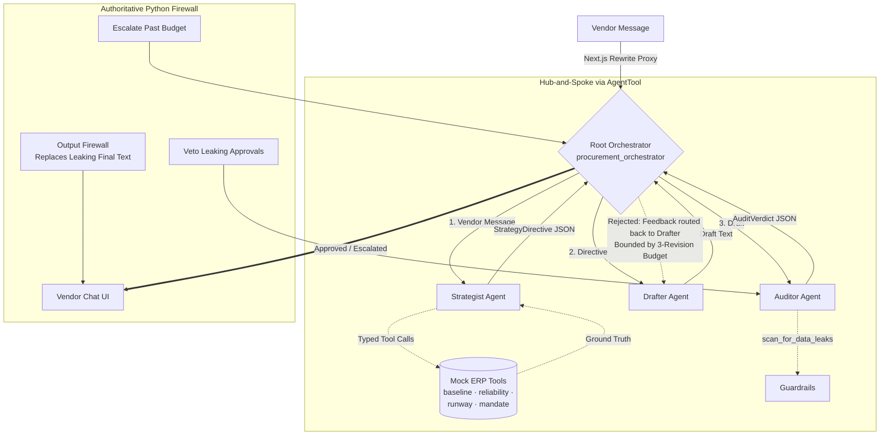

# B2B Autonomous Procurement Negotiator

[](https://github.com/DevanshMistry890/b2b-autonomous-negotiator/actions/workflows/ci.yml)

### Multi-Agent Orchestration · Generator-Critic Loop · Deterministic Compliance Firewall · Real-Time Agentic UI

An enterprise-grade autonomous supply-chain negotiation system built with **Google ADK 2.x**, **FastAPI**, and **Next.js**. Instead of relying on a single monolithic prompt—prone to hallucinations and proprietary data leaks—a silent root orchestrator delegates across a **Hub-and-Spoke Triumvirate** of specialized agents (**Strategist → Drafter → Auditor**), enforced by a **model-independent deterministic compliance firewall** that guarantees zero internal ERP data leaks.

| Component | Technology & Verification |
| --- | --- |
| **Agent Runtime & Backend** | **Google ADK 2.x (Workflow Runtime)** · **FastAPI** · **Python** |
| **State & Contracts** | **Pydantic** typed handoffs (`StrategyDirective`, `AuditVerdict`) enforced at the `AgentTool` boundary |
| **LLM Engine** | **Google Gemini** (`gemini-3.1-flash-lite-preview` default) + configurable via `NEGOTIATOR_MODEL` for **Open-Source / Local LLMs** |
| **Frontend (AG-UI)** | **Next.js 16** · **React 19** · **Tailwind CSS 4** — Dual-pane Server-Sent Events (SSE) telemetry & live run metrics |
| **Verification & CI** | **77 Pytest unit tests** + **Offline Eval Harness** (100% leak-block rate, zero API key required) + **GitHub Actions CI** |

---

## 🎯 The Engineering Problem This Solves

Generative B2B negotiation agents fail in production in two expensive ways:

1. **Proprietary Data Leaks:** A helpful LLM will happily tell a vendor *"our walk-away ceiling is $4.25/unit"*—destroying your negotiating leverage. Prompting *"please do not leak internal numbers"* is advisory, not an engineering control.
2. **Unbounded Multi-Agent Loops:** Generator-critic pipelines without deterministic state budgets get stuck in "polite infinite loops" until token quotas or rate limits are exhausted.

This system treats both as **deterministic systems engineering problems**: pairing an adversarial **Generator-Critic Loop** with an authoritative Python firewall that vetoes and replaces non-compliant outputs, governed by a strict 3-revision state machine with automatic human escalation.

---

## 🏗️ System Architecture (Hub-and-Spoke Triumvirate)



### 4-Layer Defense-in-Depth Safety Case

| Layer | Mechanism | Authority |
| --- | --- | --- |
| **1. Prompt Boundaries** | Role-scoped instructions & versioned few-shot examples (`instructions.py`) | Advisory |
| **2. LLM Auditor** | Generator-Critic compliance review returning structured `AuditVerdict` | Advisory |
| **3. Callback Veto Firewall** | Regex/keyword leak scanner with category & span detection (`guardrails.py`) | **Authoritative** — vetoes leaky approvals |
| **4. Output Firewall** | Final outbound text scanner (`loop_control.enforce_output_firewall`) | **Authoritative** — replaces unsafe text |

Even if a persuasive draft tricks the LLM Auditor into approving a message containing an internal price ceiling, **Layer 3 deterministically vetoes the approval** and forces a rewrite (`loop_converge_after_veto`).

### Generator-Critic Loop Invariants (Enforced in Code)

* **Fail-Closed Parsing:** Any malformed or unparseable verdict fails closed and is treated as a rejection (`parse_verdict_failsafe`).
* **Deterministic Veto:** An LLM approval containing a restricted metric or price ceiling is automatically voided.
* **Bounded Revision Budget:** Capped at **3 Drafter → Auditor cycles** per turn; if convergence fails, the state machine escalates to a human operator with a safe holding response.
* **Zero-Trust Output Gate:** Nothing reaches the vendor chat unless the outbound firewall verifies clean text.

---

## 📂 Repository Layout

```text
negotiator/                 # Google ADK application package
├── agent.py                # Assembly: Root orchestrator, AgentTools, enforcement callbacks
├── instructions.py         # Versioned prompt registry + dynamic state-injecting providers
├── schemas.py              # Pydantic contracts: StrategyDirective, AuditVerdict, fail-closed parsers
├── guardrails.py           # Deterministic leak firewall (categories, spans, severity)
├── loop_control.py         # Pure loop state machine (begin_turn, resolve_audit, enforce_output_firewall)
├── tools.py                # 4 Mock ERP tools + scan_for_data_leaks explainability tool
└── frontend/               # Next.js 16 AG-UI (dual-pane chat, SSE telemetry, live run-metrics strip)

tests/                      # 77 pytest unit tests (zero network calls)
evals/
├── scenarios.jsonl         # Golden evaluation fixtures (clean/leaky drafts, contracts, loops)
├── run_evals.py            # Offline evaluation harness (gates CI on safety regressions)
├── live_runner.py          # Live end-to-end ADK evaluation runner with prompt-injection tests
└── RESULTS.md              # Automated offline evaluation report
requirements.txt            # Pinned Python dependencies
.github/workflows/ci.yml    # GitHub Actions CI: pytest + offline evals + Next.js lint/build

```

---

## ⚡ Key Engineering Decisions & Tradeoffs

1. **Enforcing Guardrails in `after_model_callback` vs. `after_agent_callback`:**
In Google ADK 2.x, `after_agent_callback` *appends* an event, whereas `after_model_callback` *replaces* the model response before persistence. Running the deterministic firewall inside `after_model_callback` ensures leaky text is intercepted and replaced before it ever enters session history or the wire.
2. **Strict Pydantic Handoffs at the `AgentTool` Boundary:**
Sub-agents enforce `output_schema` contracts so broken JSON cannot cross agent boundaries. Edge parsing handles markdown-fenced JSON and currency formatting gracefully, while semantic violations fail closed.
3. **Hub-and-Spoke `AgentTool` Isolation:**
Wrapping sub-agents as `AgentTools` keeps internal reasoning chains invisible to the vendor while forwarding `state_delta` updates back to the parent session via `output_key` and dynamic instruction providers.
4. **Data-Boundary Isolation in ERP Tools:**
The Strategist queries four distinct ERP tools (`get_component_baseline`, `get_supplier_reliability`, `get_inventory_runway`, `get_negotiation_mandate`). Shareable vendor metrics are structurally separated from confidential ceiling/runway data, enforced by unit tests.
5. **Frame-Safe Server-Sent Events (SSE) Telemetry Stream:**
The Next.js frontend buffers chunked SSE frames across network reads, iterates multi-part ADK events, and routes events by author—sending root orchestrator responses to the vendor chat and sub-agent execution traces to the real-time developer telemetry console.

---

## 🧪 Verification & Offline Evaluation Suite

### 1. Run Offline Unit Tests & Golden Evals (Zero API Key Required)

```bash
# Activate virtual environment
.agentenv/Scripts/activate        # Windows PowerShell: .agentenv\Scripts\Activate.ps1

# Run all 77 unit tests (contracts, firewall, loop state machine, ERP boundaries)
python -m pytest

# Run the offline evaluation harness (generates evals/RESULTS.md)
python evals/run_evals.py

```

### 2. Offline Evaluation Results (`evals/RESULTS.md`)

| Evaluation Suite | Metric | Score |
| --- | --- | --- |
| **Guardrail Detection** | Leaky drafts blocked | **10/10 (100%)** |
| **Guardrail Detection** | Clean drafts passed (specificity) | **7/7 (100%)** |
| **Guardrail Detection** | Category precision / recall | **1.00 / 1.00** |
| **Contract Conformance** | Valid model outputs parsed | **5/5 (100%)** |
| **Contract Conformance** | Malformed outputs failed closed | **7/7 (100%)** |
| **Loop State Simulation** | Convergence, escalation & recovery scenarios | **5/5 (100%)** |
| **End-to-End Safety** | **Internal-data leak-throughs to final messages** | **0** |

---

## 🚀 Quickstart (Local Development)

```bash
# 1. Start Backend — Google ADK FastAPI Server on :8000
.agentenv\Scripts\Activate.ps1
pip install -r requirements.txt
$env:GEMINI_API_KEY="your_api_key_here"
adk api_server

# 2. Start Frontend — Next.js Agentic UI on :3000 (proxies /api/* to :8000)
cd negotiator/frontend
npm install
npm run dev

```

Open `http://localhost:3000` to interact with the dual-pane negotiation chat and live SSE telemetry console. To override the default model (e.g., for higher free-tier throughput or alternative providers), set `$env:NEGOTIATOR_MODEL="gemini-2.5-flash-lite"` before starting `adk api_server`.

---

*Architected & Engineered by [Devansh Mistry](https://devanshmistry890.github.io/) — AI Application Engineer & Data Scientist ([LinkedIn](https://www.linkedin.com/in/devansh-mistry) · [GitHub](https://github.com/DevanshMistry890)).*
